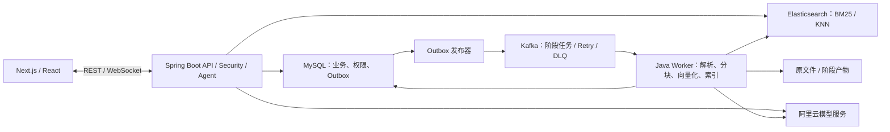

# Sky Chat：Spring Boot、MySQL、Elasticsearch 与 Kafka 重构方案

> 2026-10-20 更新：用户已明确后端继续使用 TypeScript，重点调整 RAG 技术。本篇 Java / Spring 迁移部分已由 [TypeScript RAG 方案](TypeScript-ES-Kafka-RAG重构方案.md) 取代；数据库迁移议题单独保留，本次语言调整不擅自更改该决策。

日期：2026-10-20。状态：**方案，尚未实施**。本轮未修改运行中的业务、数据库或服务配置。

目标：按照“化语智答”描述的成熟技术路线重构，核心采用 Spring Boot / Spring Security / JWT、MySQL 8.4、Elasticsearch 的 BM25 + KNN + IK + Rescore、Kafka + DLQ、ReAct 工具循环、WebSocket 流式交互；保留 Sky Chat 的通用知识工作台定位、现有前端及管理平台。2026-10-20 按最新要求将目标数据库调整为 MySQL；运行中的 Supabase 尚未迁移。

## 1. 技术栈与职责

| 层 | 方案 | 边界 |
| --- | --- | --- |
| 前端 | 保留 Next.js、React、TypeScript、现有状态管理与 Three.js 来源图 | 保留已确定的云白编辑台、管理端批量上传和流式滚动行为 |
| 同源入口 | Next.js 薄代理 + 开发/部署反向代理 | 转发 HTTP、Cookie 和 WebSocket；业务、授权、Agent 不在两套后端各维护一份；WebSocket 使用支持升级握手的代理，不伪装成普通 Route Handler 转发 |
| 业务后端 | Java 17、Spring Boot 3.5.x、Spring Security、MyBatis-Plus、Flyway | 统一负责认证、用户/组、文档/版本、会话、检索与 Agent；实施时锁定兼容的具体补丁版本 |
| 搜索 | Elasticsearch 8.19.x + 完全匹配版本的 IK 插件、官方 Java API Client | 主检索统一迁移到 ES；2048 维 dense_vector / HNSW、BM25、Rescore |
| 异步处理 | Spring Kafka + Kafka KRaft | 文档解析、分块、向量化、索引写入分阶段消费；重试、DLQ、重放 |
| 业务数据库 | MySQL 8.4 LTS / InnoDB / utf8mb4 | 账号、会话、权限、文档/版本、原文定位、任务状态、Outbox、消费幂等与检查点；为业务事实来源。原 Supabase 作为迁移数据源及切换期间回滚源 |
| 文件 | 保留持久原文件目录，增加阶段产物目录及存储接口 | API/worker 挂载共享目录；事件传产物引用，不把 PDF、大段文本或向量数组塞进 Kafka |
| 模型 | 保留阿里云聊天服务、text-embedding-v4、可选 qwen3-rerank | Embedding 改为明确请求 2048 维；模型接入通过兼容的 Spring AI/HTTP 适配层，工具循环由应用控制 |
| 调度/缓存 | Java 有界线程池、Semaphore、成熟限流组件、Caffeine + 持久缓存 | Java 链路替换 p-queue，保留其原本的批量、并发和限速职责；持久任务调度交给 Kafka |
| 流式通信 | WebSocket + 前端 ReadableStream/TransformStream 事件处理 | 阿里云 SSE 由后端消费，转换为应用事件；WebSocket 是传输，Stream API 是浏览器处理增量数据的接口 |

Spring Boot 3.5 支持 Java 17；text-embedding-v4 支持 2048 维且单批最多 10 条。实施前执行真实接口兼容性检查，不能仅改一个维度常量。参考：[Spring Boot](https://docs.spring.io/spring-boot/3.5/system-requirements.html)、[阿里云向量接口](https://help.aliyun.com/zh/model-studio/text-embedding-synchronous-api)。

本机已发现 JDK 17、Maven 和 Docker 客户端；本轮只读检查时 Docker Linux 引擎未启动。开发用 Compose 启动单节点 ES/IK、Kafka 及测试依赖；单节点配置只用于本地演示，不声明具备生产高可用。

### MySQL 迁移范围

- 新建 MySQL schema 和独立 Flyway 迁移历史，不能直接把 PostgreSQL 的 Prisma 迁移 SQL 改名执行。
- 保留现有字符串账号/会话/文档 ID、BCrypt 密码、历史消息和来源关联；不导入上游项目默认管理员覆盖现有账号，也不强制改成上游的数值 ID。
- PostgreSQL JSON 转为 MySQL JSON；tags 数组转换为关联表；时间统一按 UTC 保存。ID、哈希和幂等键选用精确匹配的排序规则，避免默认大小写不敏感规则改变唯一性。
- 业务关系和授权存 MySQL；BM25/向量索引只存 ES。旧 pgvector/tsvector 不作为目标库依赖；新向量缓存按模型/维度/哈希在 MySQL BLOB 中保存二进制数组。
- Outbox 领取使用 InnoDB 事务及 FOR UPDATE SKIP LOCKED，短事务领取并保存租约，网络发布在事务外进行；重复发布由消费幂等吸收。锁策略需配合索引、隔离级别及死锁重试验证。参考：[MySQL 锁定读](https://dev.mysql.com/doc/refman/8.4/en/innodb-locking-reads.html)。
- 切换前核对行数、引用/外键关联、密码兼容、权限集合、原文件可读及时间字段；迁移冻结旧写入或明确增量同步窗口，避免旧 PostgreSQL 和新 MySQL 同时作为业务主库。

## 2. 部署形态



先采用一个 Java 工程、API/worker 两种运行 profile，按职责拆包并支持分别启动；各阶段消费者使用独立消费组和并发配置。先完成阶段隔离和独立扩容能力，不强行部署成大量微服务。

## 3. 检索主线：IK + BM25 + HNSW KNN + Rescore

### 字段与索引

- 检索单元为子块，记录 documentId、documentVersionId、parentId、page、heading、chunkOrdinal、contentHash、modelProfile、pipelineVersion。
- 标题、标题路径、正文使用 IK；编号和资源 ID 保留 keyword 字段。正文默认索引 ik_max_word、查询 ik_smart，通过业务词典处理专业词与缩写；使用真实资料验证分词和查询差异。
- 向量为明确的 2048 维 cosine dense_vector；第一版使用浮点 HNSW，量化属于后续独立评测项，不与本次主线混在一起。
- 索引中保留 owner、库/文件可见性、授权组/账号、标签等检索过滤字段；数据库中的当前授权版本范围同时进入查询。
- 父块和原文定位保存在业务存储，命中子块后经再次授权回填，保留“命中子块 → 父上下文 → 文档版本”的来源关系。

### 查询顺序

1. Spring Security 确认用户；从数据库计算本次可访问的当前文档版本，交集限定已选择资料和标签。
2. 并行执行两路 ES 检索：BM25 使用标题/标题路径/正文权重；KNN 使用查询向量、HNSW 和预过滤。
3. BM25 路径对前排窗口使用 ES Rescore，例如 match_phrase 加权，改善编号、专有短语和顺序匹配。初始候选 50、Rescore 窗口 100；KNN 初始 k=50、num_candidates=200，均为待调优参数。
4. Java 服务对两路实际排名执行标准 RRF，避免直接相加 BM25 和余弦分数。该层处理融合，不替代 ES 的 BM25、KNN 或 Rescore。
5. 可选对融合候选执行 qwen3-rerank；预算不足或重排超时，保留融合结果并记录原因。
6. 重新校验资料权限与当前版本，按父块去重和文档多样性选出上下文，再回填父块。
7. Agent 使用实际检索结果生成答案并校验引用；无证据时不生成虚构引用。

这里明确分开 **ES Rescore**（候选窗口的二次相关性计算）与 **模型重排**（外部相关性模型），不会把两者混称。

ES 8.19 的内置 RRF 不支持直接与 rescore 组合，所以首版将 Rescore 放在 BM25 查询路径、融合放在 Java 层。参考：[RRF 限制](https://www.elastic.co/guide/en/elasticsearch/reference/8.19/rrf.html)、[ES 混合检索与 KNN](https://www.elastic.co/guide/en/elasticsearch/reference/8.19/knn-search.html)、[Rescore](https://www.elastic.co/guide/en/elasticsearch/reference/8.19/filter-search-results.html#rescore)。

所有强制范围条件进入 BM25 bool.filter 与 KNN 自身 filter。KNN 只在外层再过滤可能导致候选不足，不能拿后置过滤代替预过滤。参考：[KNN 预过滤](https://www.elastic.co/docs/reference/query-languages/query-dsl/query-dsl-knn-query)。

## 4. Kafka 入库：持久、可恢复、可重放

```text
上传原文件 → 数据库事务：文档/版本、任务、Outbox
  → Outbox 发布器 → parse.requested
  → 解析产物 → chunk.requested
  → 父子/语义分块产物 → embed.requested
  → 向量产物 → index.requested
  → ES Bulk 写入并确认可搜索 → 数据库标记 ready / 切换版本

阶段失败 → 按分类重试 → 达到上限进入该阶段 DLQ
```

- 使用 Spring Kafka 监听器、重试和 DLT/DLQ 基础设施；管理端统一显示失败阶段、错误分类、尝试次数与恢复入口。
- 事件包含 eventId、documentId、documentVersionId、pipelineVersion、stage、artifactRef、traceId；以文档家族 ID 为 key，常规事件保持分区内顺序。
- Outbox 与业务记录在同一个 MySQL 事务写入；发布器收到 Broker 确认后才标记已发送。发布后崩溃可能重复发送，交给消费幂等处理。
- 每阶段以 eventId/阶段及文档版本建立唯一处理记录；产物、块和索引使用稳定 ID。外部写入成功但 Offset 尚未提交时重投，结果不能重复。
- 瞬态网络/429/服务故障退避重试；文件损坏、无可解析文本、非法维度等永久错误进入 DLQ；不循环重试无效密钥。
- 处理完成并提交业务检查点/下一阶段 Outbox 后，才允许提交消费进度；不宣称跨 Kafka、MySQL 和 ES 自动获得端到端 Exactly Once。
- 非阻塞重试可能改变顺序；消费者必须检查版本和 pipelineVersion，禁止旧任务回放覆盖新版本。删除标记也参与检查，防止已删除资料被旧事件重新索引。
- DLQ 重放调用真实阶段消费者，保留原事件与重放关联。已经确认成功的阶段复用检查点；不能把“重新跑整份文件”当作断点续传。

参考：[Spring Kafka 重试](https://docs.spring.io/spring-kafka/reference/retrytopic/retry-config.html)、[重试对顺序的影响](https://docs.spring.io/spring-kafka/reference/retrytopic/how-the-pattern-works.html)、[Kafka 消息语义](https://kafka.apache.org/41/design/design/)。

## 5. 分块和向量化增强

- 保留 PDF 页码、Markdown 标题路径、Unicode 边界保护；Java 侧复用 Apache PDFBox/Tika 等成熟解析组件，避免自行解析 PDF。
- 默认结构递归父子分块；保留原有约父 1800、子 480、重叠 60 个 Unicode 字符的可配置预算。语义策略使用相邻短段向量距离与长度约束，额外请求和耗时单独计入指标。
- 2048 维必须新生成，不能把旧 1024 维补零；缓存键包含账号、模型/地址、维度、文本哈希和处理配置。
- 向量请求按单批最多 10 条、有界并发起步；消费线程数、API 并发和服务商 RPM 分开配置。429 按服务端提示退避，成功后逐步恢复并发。
- 输出按输入序号校验并还原；成功批次独立缓存，大文件重试复用已完成批次。
- 使用有容量/TTL 限制的 Caffeine 作为一级缓存，MySQL 二进制缓存作为持久层。新缓存不依赖旧 vector(1024) 列，避免为哈希查找保留一套旧向量检索。
- 多 worker 首版按服务商配额显式分摊并发与 RPM，验收总请求量；不把进程内限流写成分布式全局限流。
- ES Bulk 逐项检查失败结果，只补偿失败项；最终校验块数与处理配置，再发布 ready 状态。

## 6. Spring Security 与资源权限

基础范围为私有、组织组及子组、公开给登录用户；组织组可以表示院系、部门或项目组。保留文件级账号/用户组授权，对库级范围进一步收紧。

- SecurityFilterChain 统一处理 JWT、认证失败与接口角色；使用成熟 JWT 校验组件，不自行编写密码学验证。
- 保留现有 BCrypt 密码兼容；JWT 迁移期兼容现有账号标识与签名配置。角色/组成员状态从数据库获取，避免长期 Token 固化旧授权。
- 每次检索先从数据库计算本次已授权的当前文档版本集合；该集合及 ES 权限字段共同约束 BM25/KNN，客户端不能上传自己的组路径或替换服务端范围。
- 对当前产品的有界文件选择范围，版本 ID 预过滤可保持可控。跨所有大规模知识库的授权查询如需支持，需单独评估 terms 范围大小，不能直接无限扩展这一方案。
- 文件 ACL、组成员、草稿/发布状态和删除首先更新数据库；ES 通过事件同步，但不能因为索引更新延迟继续放出旧权限资料。模型重排、父块回填与原文响应前再次校验。
- 授权收紧覆盖整个文档版本家族；旧回答已发送的文本不重写，新的检索和原文读取采用最新权限。
- WebSocket 握手校验身份和 Origin；HTTP 使用 HttpOnly Cookie 的路径处理 CSRF；JWT/供应商密钥不出现在 URL 或浏览器日志中。

参考：[Spring Security JWT](https://docs.spring.io/spring-security/reference/servlet/oauth2/resource-server/jwt.html)。

## 7. Agent、WebSocket 与前端流式链路

- 迁移现有工具循环和参数白名单，工具限定 searchKnowledge、readSourceContext、summarizeDocuments 等已授权操作；每次工具调用重新应用资源范围。
- 支持追问改写、必要时拆分子问题、有限补查和多文档摘要；保留轮次、工具次数、Token、总时限、单工具超时及重复调用复用。
- 通过 WebSocket 传 start/cancel 与 accepted、tool_start、tool_result、text_delta、completed、error 等事件；统一 requestId、runId 和递增 seq。
- 事件分批持久化；前端按序号去重、requestId 隔离。重连可补齐已持久化内容，服务进程重启后把中断任务标记为 interrupted，不伪装为模型请求仍在继续。
- 浏览器将 WebSocket 事件适配成统一增量流，经缓冲批量提交到 React；继续保留已优化的 Markdown 渲染、上翻位置和跟随底部行为。
- 管理端观察 Kafka 阶段；聊天端只选择共享资料与查看来源。Three.js 继续使用实际来源关系，新后端只替换数据适配。

## 8. 版本与跨存储一致性

新版本按以下顺序发布：

1. 创建独立版本并处理，原版本保持可用。
2. ES 完成新版全部子块写入，检查 Bulk 结果并等待必要的刷新，使其可检索。
3. 数据库事务切换当前版本并迁移会话选择。
4. 新查询只允许数据库认定的当前版本；旧索引记录不会因为更新延迟混进回答。

ES 写入后数据库切换失败时，幂等重试或后台对账处理孤立索引。原文件、原有片段与旧引用保留；删除使用数据库标记和版本防护，后台异步清理索引。记录各阶段状态与待补偿项，不声称跨存储有原子事务。

整库从 1024 维迁移到 2048 维时新建独立 ES 索引与别名，完成校验后切换，不覆盖旧数据。文件当前版本切换由数据库指针控制，不需要为每个文件创建一个 ES 索引。

## 9. 迁移范围与代码组织

建议目录：

```text
sky-chat/
  app/、components/、store/       保留现有前端
  server/                       新 Java Maven 工程
    auth/、knowledge/、document/、conversation/
    retrieval/、ingestion/、agent/、transport/
  infra/                        Compose、ES/IK 镜像、Kafka 配置
  docs/                         接口/事件契约、迁移和验收记录
```

- 保留现有 HTTP 路径与主要响应结构，以契约测试约束替换；流式事件增加 WebSocket 协议适配层。
- 认证、会话、文档、权限、Agent 和检索最终归 Java 所有，Next.js API 仅保留必要代理与前端监测入口。
- 通过 Flyway 初始化和管理目标 MySQL schema；原 Prisma/PostgreSQL 仅作为迁移源，先定义字段与 ID 映射，不让两套工具同时改变目标业务表。
- 原有账户、会话和来源 ID 不重置；Java 读取历史表并维护必要映射。历史片段不依赖旧向量仍可显示原文，引用接口采用统一授权。
- 迁移期间通过明确开关选择旧/新后端，暂存旧 Node worker 和 pgvector 作为回滚路径；新链路通过验收后停用旧写入，避免重复处理。

## 10. 实施顺序与验收

| 阶段 | 交付 | 验收 |
| --- | --- | --- |
| 1. 基础与契约 | Java 工程、Security/JWT、HTTP/WS 契约、MySQL/ES/IK/Kafka Compose、MySQL schema 与迁移演练 | 原账户可登录；旧库不重置；数据/引用/权限核对；依赖健康；越权接口拒绝；版本全部锁定 |
| 2. ES 检索替换 | 2048 维索引、IK、BM25、HNSW、Rescore、融合、权限过滤、父块回填 | 查询确实使用 BM25 和 HNSW；编号/专业词可检索；当前版本与权限条件同时作用于两路 |
| 3. Kafka 入库 | Outbox、四阶段消费者、缓存、重试/DLQ、幂等、重放与版本发布 | 中途杀进程可恢复；重复事件不重复写入；旧版本/删除事件不能复活资料；Bulk 部分失败可补偿 |
| 4. Agent 与流式 | Java 工具循环、WS 增量/状态、取消与重连、管理台接入 | 跨文件问答、摘要与追问；引用对应实际片段；取消无残留调用；重连不重复；流式上翻不跳动 |
| 5. 评测与切换 | 检索实验台、队列诊断、自动化测试、数据迁移和回滚演练 | 固定独立测试集、权限与故障矩阵通过；新旧切换可回滚；只按实际结果更新简历 |

评测至少覆盖 BM25、KNN、混合、混合+Rescore、混合+Rescore+模型重排，使用相同资料与权限范围。扩充现有 42 题，目标为至少 100 个标注问题，并拆分调参集与冻结测试集；保存 Recall@K、MRR、nDCG、P50/P95、重排调用及费用相关计数。

容量验证从约 1 万分块开始，资源允许后扩展；对 HNSW 候选与同过滤范围的精确向量结果测近似召回。真实语义评测与合成向量容量测试分别记录，不把合成数据成绩当作业务答案效果。

关键故障用例：Outbox 已发送未标记、消费成功未提交 Offset、重复事件、重试乱序、部分向量/ES Bulk 失败、新版处理中删除、旧版失败事件重放、ES ACL 更新延迟、成员/角色撤销、模型超时与取消、WebSocket 断线重连。

最终项目的额外亮点由以下证据支撑：父子/语义分块与上下文回填、Outbox 和幂等/DLQ 重放、向量并发/缓存、版本与权限一致性、可观察的 Agent/流式链路，以及可复现的检索消融。完成前均不得写成已实现的简历成果；2048 维也不作为效果提升本身的证明。

## 11. 开源复用原则与选型

优先直接使用 Spring AI Alibaba 的 Agent 框架、Spring Kafka 的消费/重试/DLQ、官方 Elasticsearch Java Client 的查询及 BulkIngester、Tika/PDFBox 等库。Ragent 的检索后处理、分块与入库节点按许可证抽取适配；芋道的知识管理和数据权限模块作为候选，按实际耦合选择性采用。

不同时引入多套 Agent、身份与数据实体体系。保留 Sky Chat 的接口、数据和权限语义，额外开发聚焦 ES/Kafka 适配、资源 ACL、Outbox/幂等、版本一致性和前端事件协议。开源候选已核对固定提交源码，但尚未在本机编译运行，不将候选模块写成已集成成果。

具体源码位置、版本差异、许可证与采用边界见 [Java 开源复用选型](Java开源复用选型.md)；研究快照见 [java-rag-candidates.json](research/java-rag-candidates.json)。
