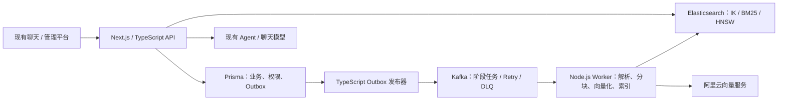

# Sky Chat：TypeScript + Elasticsearch + Kafka RAG 重构方案

日期：2026-10-20。状态：**已实现并完成核心真实链路验收**。本机已切换 ES / Kafka，两份旧资料完成2048维索引重建。以下保留方案结构，最终代码、实测结果及单节点限制见 [实现记录](../reports/rag-distributed-implementation.md)；部署与回滚见 [操作文档](ES-Kafka-部署与验收.md)。

按最新要求，后端继续使用 TypeScript / Node.js。本次重点是 RAG 检索与入库技术，不迁移到 Java / Spring，不重写现有认证、会话和前端。此前 Java 方案中的 RAG 设计迁移到本方案，数据库选型/迁移单独处理，不作为引入 ES、Kafka 的前置条件。

## 1. 技术栈与范围

| 职责 | 方案 |
| --- | --- |
| Web/API | 保留 Next.js Route Handlers、Node.js runtime、TypeScript |
| 账号、会话、权限 | 复用 Prisma、JWT、用户组闭包表、库/文件 ACL 和版本模型 |
| 主检索 | Elasticsearch + 匹配版本的 IK；使用官方 `@elastic/elasticsearch` TypeScript 客户端 |
| 向量检索 | 阿里云 text-embedding-v4，明确请求 2048 维；ES dense_vector / HNSW |
| 异步管道 | Kafka + KafkaJS，独立 Node.js/TypeScript worker、分阶段消费者 |
| 分块 | 保留 `@langchain/textsplitters`、中文/Unicode 边界、父子结构及可选语义策略 |
| 向量调度 | 保留 p-queue：批量、进程内并发、RPM 和查询优先；Kafka 负责持久任务，不混淆两层职责 |
| 模型与 Agent | 复用现有阿里云接入、Tool Calling 循环、预算与工具授权；替换检索实现 |
| 流式与 UI | 保留现有 SSE/Stream API、滚动定位、来源与 Three.js 数据契约；管理端增加 Kafka 诊断 |

Prisma 背后的业务数据库负责元数据、权限、状态、Outbox、检查点和幂等记录；BM25/向量检索统一由 ES 承担。已有数据库迁移议题保持独立，本轮不擅自更改或撤销。

参考：[Elasticsearch JavaScript/TypeScript 客户端](https://www.elastic.co/docs/reference/elasticsearch/clients/javascript/typescript)、[KafkaJS 消费接口](https://kafka.js.org/docs/consuming)。实施前锁定 ES/IK、客户端与 Kafka Broker 的兼容版本，并执行真实连接、生产/消费和重平衡验证。

## 2. 整体链路



API 与消费者为独立进程。PDF 解析等 CPU 密集操作进入 worker 线程或受控子进程，避免阻塞 Web 请求及 Kafka 心跳；不将所有阶段塞进 Next.js 请求生命周期。

## 3. 检索：BM25 + KNN + IK + Rescore

### 索引

- ES 子块索引保存正文、标题、标题路径、页码、parentId、documentId、documentVersionId、pipelineVersion、标签及授权过滤字段。
- 标题/正文使用 IK；默认索引 ik_max_word、查询 ik_smart，增加专业名词/缩写词典。编号、资源 ID 使用 keyword 字段，避免仅依赖分词。
- embedding 为 2048 维 cosine dense_vector，第一版使用浮点 HNSW；量化作为后续独立评测项。
- 父块、原文与历史来源继续保留在业务存储，命中后经授权回填。

### 查询

```text
数据库计算本次授权的当前文档版本、所选范围和标签
  ├─ IK + BM25：标题/标题路径/正文加权 → 窗口 Rescore
  └─ 查询向量 + HNSW KNN：相同范围预过滤
       ↓
TypeScript 标准 RRF 融合
       ↓
可选 qwen3-rerank → 权限复核 → 父块回填/去重 → Agent 回答与引用
```

- BM25 路径以 match_phrase 等 ES Rescore 提高完整短语、专有词和顺序匹配的相关性；它与外部模型重排分别计量。
- 初始 BM25 候选 50、Rescore 窗口 100；KNN k=50、num_candidates=200，均通过独立调参集调整。
- BM25 bool.filter 和 KNN 自身 filter 都执行权限、版本与范围约束；不能只使用外层 post-filter。
- ES 8.19 内置 RRF 不支持直接搭配 Rescore，所以明确在 BM25 查询路径执行 Rescore，在 TS 层融合实际排名；RRF 是标准算法，不重新发明排序规则。
- 模型重排超时可退回融合结果，向量服务故障可保留关键词结果，并暴露实际降级原因。

参考：[ES KNN](https://www.elastic.co/guide/en/elasticsearch/reference/8.19/knn-search.html)、[KNN 预过滤](https://www.elastic.co/docs/reference/query-languages/query-dsl/query-dsl-knn-query)、[RRF 与 Rescore 的组合限制](https://www.elastic.co/guide/en/elasticsearch/reference/8.19/rrf.html)。

2048 维必须重新生成，不能将原 1024 维补零。新旧索引按 generation 隔离；generation 记录模型、维度、分块配置和就绪状态，避免修改一个全局 profile 后破坏旧链路回滚。参考：[阿里云向量接口](https://help.aliyun.com/zh/model-studio/text-embedding-synchronous-api)。

## 4. 入库：KafkaJS 阶段消费者

```text
批量上传原文件
 → Prisma 事务写文档/版本、处理状态、Outbox
 → Outbox 发布器
 → parse.requested：解析 PDF / Markdown / 文本
 → chunk.requested：父子/可选语义分块
 → embed.requested：批量向量化及缓存
 → index.requested：ES Bulk 写入与逐项校验
 → 确认可搜索，事务发布当前版本
```

### 事件与可靠性

- 事件包含 eventId、documentId、documentVersionId、pipelineVersion、stage、artifactRef、traceId；以文档家族为 key。Kafka 传文件/产物引用，不传原 PDF 或大量向量数组。
- Outbox 和业务数据在同一事务保存；发布器收到 Broker 确认后才标记发送。重复发布由消费幂等吸收。
- KafkaJS 消费者显式控制完成和 Offset 提交；业务检查点、幂等状态和下一阶段 Outbox 成功后才能确认进度。长任务定期心跳，识别停止/失效批次，不能因过早提交跳过未完成任务。
- 以 eventId/阶段、文档版本与稳定块 ID 去重，ES 使用确定性 `_id`；重投不能重复建块。
- 网络、429、临时服务故障进入退避重试；文件损坏、非法维度等永久错误进入阶段 DLQ。业务处理重试单独实现，不能把 KafkaJS 客户端网络重试误认为文档处理重试。
- 重试/DLQ 的发送也通过业务 Outbox 或等价可靠机制完成；持久记录重试成功后再推进原 Offset，防止消息在转移时丢失。
- 延迟重试不长时间阻塞整个消费者；以持久化的 nextAttemptAt 管理到期重试，不假设 Kafka 原生提供任意延迟消息。消费者仍检查版本，防止重试乱序覆盖新结果。
- 管理端支持查看失败阶段、错误分类、尝试次数和人工重放，保留原事件及重放关联。旧版本/已删除资料的事件重放必须拒绝激活。
- 不宣称 Kafka 事务能自动覆盖 Prisma、文件和 ES 写入。采用可恢复、至少一次处理和幂等副作用。

参考：[KafkaJS Offset、心跳与并发](https://kafka.js.org/docs/consuming)、[KafkaJS 事务边界](https://kafka.js.org/docs/transactions)。

### 并发、缓存与背压

- 分别配置分区消费并发、单文件分块批次和向量请求并发；消费者扩容受分区数限制，同一分区不盲目并行乱序处理。
- p-queue 保留批量最多 10 条、请求并发/RPM、429 退避、查询优先和响应序号还原。多个 worker 按供应商额度分摊配置，不将单进程限流宣传成全局限流。
- 向量缓存键包含账号、模型/地址、2048 维度及内容哈希；保留容量/TTL 限制的内存缓存，新持久缓存以 Prisma Bytes 等二进制形式存储，不需要对缓存执行向量相似度检索。
- 解析产物和成功向量批次分别持久化；恢复时复用，不从头重算所有内容。
- 超过处理容量时暂停相应分区/限制领取，不让大量任务无限积压在 Node.js 内存；重试等待不占满全部请求槽位。
- ES Bulk 检查每个 item，补偿失败项，按块数与 generation 校验完成后发布 ready。

## 5. 权限、版本与来源一致性

- 保留 JWT、角色、用户组闭包表和库/文件范围交集，角色与成员变更从业务库读取；不移植 Spring Security Filter Chain。
- 查询前从业务库计算允许的当前文档版本，作为两路检索的共同范围；ES 冗余权限字段用于检索过滤，但不是最终授权事实。
- 模型重排、父块回填、原文/下载和历史来源响应前再次校验，避免 ES ACL 同步延迟泄漏资料。
- 新版 ES 写入完成并可搜索后，再切换业务库当前版本；失败保留旧版，旧回答引用仍可定位历史片段。
- 删除/撤权首先在业务库生效，索引异步清理；版本和删除标记阻止旧任务复活资料。
- 迁移时保留现有账号、会话、原文件和引用 ID；新建 ES 索引/别名与 generation，旧 pgvector 路径仅在迁移窗口作为显式回滚选项，切换后统一停用旧任务领取。

## 6. 现有 Agent、前端和管理台如何复用

Agent 调用统一的 RetrievalService 接口，保留现有问题改写、拆分、工具白名单、预算、去重、取消及执行记录。检索实现切到 ES 后，来源仍保留命中子块、父块、页码、文档版本和本次 runId。

前端继续使用现有 SSE/Stream API 和已经修复的流式滚动；本次不把重写通信协议作为 RAG 升级前置。管理端增加阶段状态、Kafka 积压/延迟、重试/DLQ 与重放入口，检索实验台展示 BM25/KNN/Rescore/融合/模型重排的真实诊断。

## 7. 建议代码组织

```text
lib/rag/search/                 ES 客户端、mapping、查询与统一检索接口
lib/rag/messaging/              KafkaJS、Outbox、消费者、重试/DLQ
lib/rag/pipeline/stages/        parse / chunk / embed / index
lib/rag/                       复用分块、缓存、权限与来源组件
scripts/rag-worker-*.ts         独立 Node.js 入口，按阶段启动
infra/                         Kafka / ES / IK 的 Compose 和镜像配置
app/api/、lib/agent/            保留现有 API 与 Agent，逐步接入新接口
```

复用优先：ES 官方 TS 客户端、KafkaJS、LangChain textsplitters、p-queue，以及现有已经验证过的文件、权限和流式代码。只自行实现与本项目业务相关的阶段状态机、授权组合和版本一致性。

## 8. 实施顺序与验收

| 阶段 | 交付与验收 |
| --- | --- |
| 1. 基础与契约 | ES/IK、Kafka Compose；TS 客户端、事件契约、检索接口与 generation；真实连接、生产/消费及兼容性验证 |
| 2. 搜索替换 | BM25、KNN、IK、Rescore、RRF、2048 维、共同权限过滤和父块回填；保留旧路径对照 |
| 3. Kafka 入库 | Outbox、四阶段消费者、幂等、检查点、重试/DLQ、重放、ES 部分失败恢复和版本发布 |
| 4. 界面与 Agent 接入 | 批量上传、处理状态、DLQ 控制、实验台、真实引用及现有流式行为回归 |
| 5. 评测与切换 | 检索消融、容量/并发与故障注入、权限同步延迟检查、数据核对和回滚演练 |

检索对比覆盖 BM25、KNN、混合、混合+Rescore、混合+Rescore+模型重排；使用相同数据、权限与配置。扩充现有 42 题，目标至少 100 个标注问题，分开调参集和冻结测试集，记录 Recall@K、MRR、nDCG、P50/P95、缓存命中和调用量。

容量从约 1 万分块开始，资源允许后扩展；HNSW 对照相同过滤范围的精确向量结果测近似召回。语义质量测试与合成向量容量测试分别报告，不提前承诺性能百分比。

关键故障测试：Outbox 已发送但未标记、消费成功但未提交 Offset、重复消息、重试乱序、重平衡、长解析心跳、向量部分失败、ES Bulk 部分失败、处理中删除、新旧版本交错、ES ACL 同步延迟、撤权、模型取消和流式阅读位置。

目标成果是 TypeScript 实现的成熟 RAG 链路，并以父子/语义分块、Outbox/幂等/重放、向量并发缓存、版本与权限一致性及可复现消融作为额外深度。实施并验收前，不将这些方案写成新的已实现简历成果。
